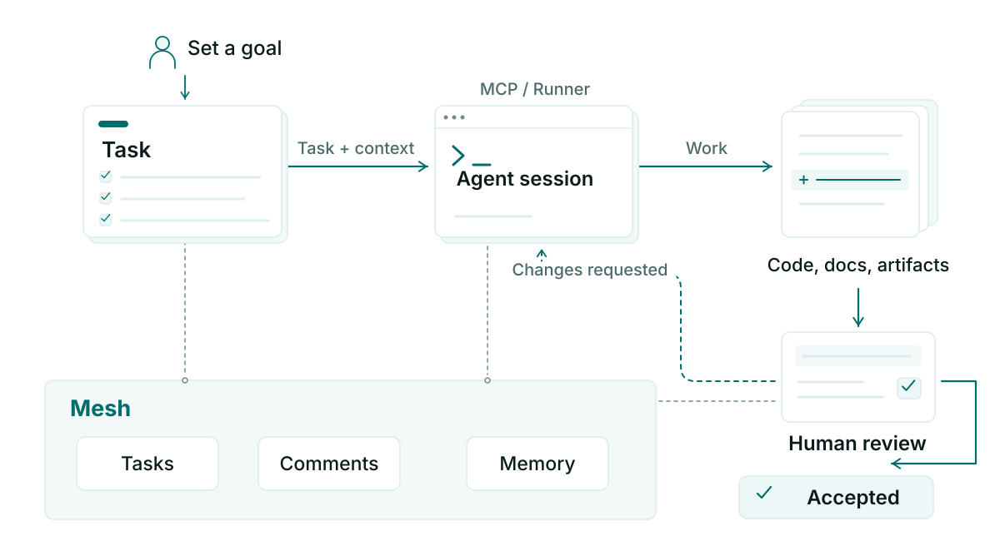
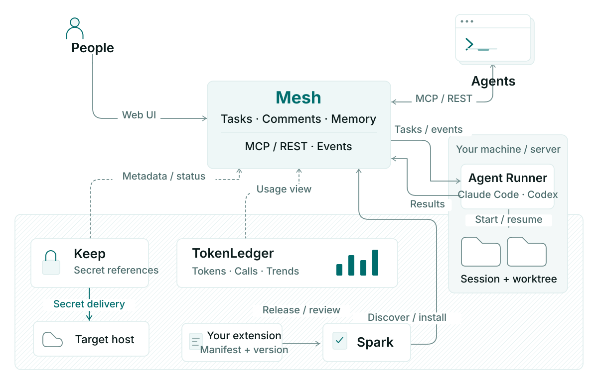

# Tools for teams of people and AI agents

[Mesh](https://github.com/entire-vc/evc-mesh) is an open-source workspace where people and AI agents work on the same tasks. People set goals and accept results. Agents pick up work, share progress and bring back code, documents or other artifacts. Decisions and feedback stay with the task, so the next step starts with context.

We build Mesh and the tools around it — and use them to run our own work.

## From a goal to a result

<picture>
  <source media="(max-width: 600px) and (prefers-color-scheme: dark)" srcset="assets/work-loop-compact-dark.svg">
  <source media="(max-width: 600px)" srcset="assets/work-loop-compact-light.svg">
  <source media="(prefers-color-scheme: dark)" srcset="assets/work-loop-dark.svg">
  <source media="(prefers-color-scheme: light)" srcset="assets/work-loop-light.svg">
  
</picture>

## Mesh: one workspace for the whole team

Use a board, list, timeline or calendar to plan work. Connect agents through MCP or the REST API. Both sides share tasks, comments, memory and a real-time event stream, so handoffs happen in the workspace where the work is tracked.

Mesh is self-hosted. Start with one agent, then add automation and extensions as your team needs them.

**Start here:** [Quick Start](https://github.com/entire-vc/evc-mesh/blob/main/docs/quickstart.md) · [Self-hosting](https://github.com/entire-vc/evc-mesh/blob/main/docs/self-hosting.md) · [Connect an agent](https://github.com/entire-vc/evc-mesh/blob/main/docs/agent-onboarding.md) · [Mesh overview](https://entire.vc/mesh/)

## Add the capabilities your team needs

<picture>
  <source media="(max-width: 600px) and (prefers-color-scheme: dark)" srcset="assets/mesh-system-compact-dark.svg">
  <source media="(max-width: 600px)" srcset="assets/mesh-system-compact-light.svg">
  <source media="(prefers-color-scheme: dark)" srcset="assets/mesh-system-dark.svg">
  <source media="(prefers-color-scheme: light)" srcset="assets/mesh-system-light.svg">
  
</picture>

### Agent Runner — keep work moving across sessions

[Agent Runner](https://github.com/entire-vc/evc-mesh-runner) runs Claude Code and Codex agents on Mesh tasks. Each task gets its own session and isolated Git worktree. An agent can work on several tasks within its concurrency limit; when a task waits for review, a merge or an answer, its session can resume with the context it already has.

Run it on your own machine or server to turn a Mesh task queue into ongoing agent work. The board remains the place for progress, handoffs and human decisions.

### Keep — give agents access without giving them secret values

[Keep](https://github.com/entire-vc/evc-keep) stores and delivers secrets for people, services and agents. Agents work with references and metadata; Keep delivers values on the target host, outside the model's context. Host identity, policies and signed delivery jobs control where a value can go.

Use it standalone or as a Mesh extension to see secrets, their versions and delivery status in your workspace. Rotation can deliver a new version to its consumers, verify the result and retire the old one. [Keep Rotator](https://github.com/entire-vc/evc-keep-rotator) adds rotation for Mesh agent keys and Keep's own service token.

### TokenLedger — see where agent usage goes

TokenLedger brings token and call usage into Mesh: current usage, daily trends and breakdowns by agent, model, CLI and account where data is available. A change log helps you compare usage before and after changes to model selection or routing.

Use it to understand which workflows consume resources and investigate changes with context. TokenLedger is in early development; it does not yet have a public Spark catalog release.

### Connect your own agents and tools

| Tool | What it adds |
|---|---|
| **[Mesh MCP](https://github.com/entire-vc/evc-mesh-mcp)** | Tasks, comments, shared memory and handoffs for MCP clients such as Claude Code, Cursor, Cline and OpenClaw. |
| **[OpenClaw Skill](https://github.com/entire-vc/evc-mesh-openclaw-skill)** | A workflow for OpenClaw agents to take tasks, report progress and share memory through Mesh. |
| **[Extension Template](https://github.com/entire-vc/mesh-extension-template)** | A starting point for an extension with a manifest, signed events and install flow, UI slots and a health check. |
| **[Fleet Starter](https://github.com/entire-vc/evc-mesh-fleet-starter)** | Legacy feeder and dispatcher setup. Use Agent Runner for new installations. |

All Mesh tools are Apache-2.0.

**Status:** Mesh is in alpha, Keep is pre-alpha and TokenLedger is in early development. APIs may change between versions. Early adopters and feedback are welcome.

## Build an extension. Share it through Spark.

Add a workflow, an integration or a tool your team needs, then make it available to other Mesh teams through the [Spark extension catalog](https://spark.entire.vc/mesh-extensions).

1. **Build from the [Extension Template](https://github.com/entire-vc/mesh-extension-template).** Describe your extension in `mesh-extension.json`: its identity, permissions, events, endpoints and UI slots. Add a README and license, including disclosures about network access, accounts and telemetry.
2. **Validate and tag a release.** Run `mesh-ext validate . --tag 0.1.0`, commit your release and push a matching version tag. Spark checks the source at that tag.
3. **Submit through Spark.** Sign in and open **Profile → My Tools → Mesh extensions**. Publishing requires publisher access. Submit your repository and version in the publisher cabinet, or use `mesh-ext publish .` with the publisher CLI configured.
4. **Pass checks and review.** Spark checks the manifest, compatibility, permissions, disclosures and security findings. A first release goes through moderation; after publication, teams can discover it in Spark and connect it from Mesh.

The [extension developer guide](https://spark.entire.vc/api/v1/mesh-extensions/docs/developer-guide) covers publisher access, CLI setup, release rules and the review process.

## More tools from Entire VC

### Team Relay — a shared knowledge base, built from your notes

[Team Relay](https://github.com/entire-vc/evc-team-relay) turns an Obsidian vault into a space your team can edit together in real time. Work offline and sync when you reconnect, share folders with viewers or editors, and publish selected notes as a wiki, client portal or documentation site with public or restricted access.

Keep team knowledge in Markdown while giving agents access through MCP or REST. People can refine a brief in Obsidian while agents read the same knowledge base and contribute updates.

[Team Relay Sync plugin](https://github.com/entire-vc/evc-team-relay-obsidian) · [Install for Obsidian](https://community.obsidian.md/plugins/team-relay-sync) · [MCP server](https://github.com/entire-vc/evc-team-relay-mcp) · [OpenClaw skill](https://github.com/entire-vc/evc-team-relay-openclaw-skill)

### Local Sync — connect Obsidian notes to your coding projects

[Local Sync](https://github.com/entire-vc/evc-local-sync-plugin) syncs Markdown between your Obsidian vault and local project folders used by Claude Code, Cursor or VS Code. Map the folders you need, choose manual or automatic syncing, and preview changes with a dry run.

Write a specification in Obsidian and make it available in your project. Bring documentation written by an agent back into your vault. Both sides work with ordinary local files.

[Install Local Sync](https://obsidian.md/plugins?id=evc-local-sync)

### Spark — find tools for the work in front of you

[Spark](https://spark.entire.vc) is a catalog of agents, skills, prompts, MCP connectors and Mesh extensions. Browse by the task you want to solve, find a tool and bring it into your workflow.

Use [Spark MCP](https://github.com/entire-vc/evc-spark-mcp) to let an agent search the catalog and read an asset's contents from its existing MCP client: `npx evc-spark-mcp`. Build a Mesh extension of your own and use the publication flow above to share it with other teams.

## Community

[entire.vc](https://entire.vc) · [Telegram](https://t.me/entire_vc) · [X](https://x.com/entire_vc) · in@entire.vc

Every repository has its own contributing guide. General flow: fork, branch, pull request; we use conventional commits. Check each repository for its license.
